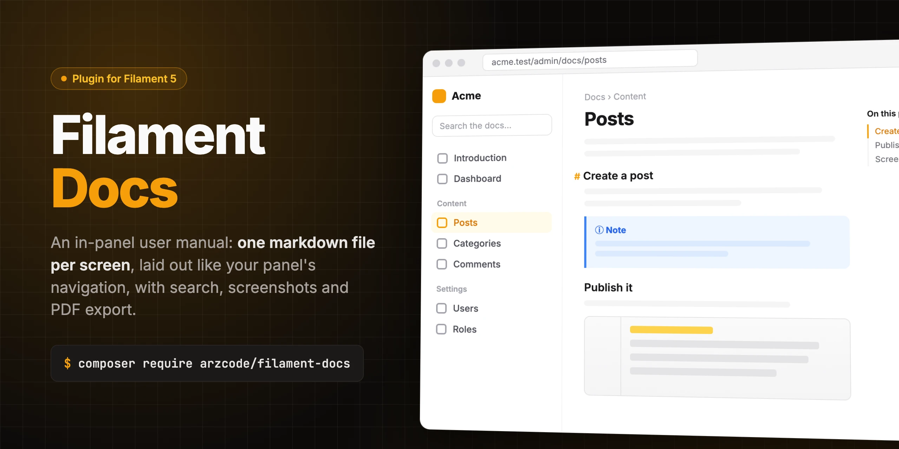

An in-panel user manual for Filament: one markdown file per screen, laid out exactly like the panel's own navigation,
with search, a contents list, callouts, a pager and optional screenshots taken by Playwright.

- The sidebar of the docs **is** the panel's navigation, with each documented screen replaced by its doc: same groups,
  same order, same labels and icons. Move or rename a screen and its doc follows.
- A reader only sees, searches and opens the docs of the screens they can open. Any other doc answers 404, and so do
  its screenshots.
- Search needs every word to match, ignores accents and ranks a match in the title above one in a heading, above one in
  the body. A result opens at the section that holds the match, with the phrase and the words highlighted where a
  word starts, short words such as "de" only within the phrase.
- `> [!NOTE]`, `[!TIP]`, `[!IMPORTANT]`, `[!WARNING]` and `[!CAUTION]` become callouts, `[Users](users.md)` links to
  that doc, and every `##`/`###` gets an anchor and a place in the "On this page" list.
- **Export PDF** in the page header downloads the open doc, or the whole manual with a cover and a contents list, as a
  PDF of only the docs the reader may open. The file is named after `app.name`: `Documentation Acme.pdf` for the
  manual and `Documentation Acme - Posts.pdf` for one doc (translated through `filament-docs::docs.pdf.*_filename`).
- `php artisan docs:screenshot` photographs every documented screen and embeds the images into the docs.

## Requirements

- PHP 8.4+, with the `gd` extension and WebP support for the screenshots in the PDF
- Laravel 12 or 13
- Filament 5.8+, with a [custom theme](https://filamentphp.com/docs/styling/overview#creating-a-custom-theme) for each
  panel that shows the docs

## Installation

```bash
composer require arzcode/filament-docs
php artisan filament-docs:install
```

The installer:

1. asks whether to publish the config file (`config/filament-docs.php`);
2. asks, for each `app/Providers/Filament/*PanelProvider.php`, whether to register `FilamentDocsPlugin` in it. When
   the panel already serves `/docs`, it asks for another path and registers the plugin with `->slug()`;
3. asks, for each `resources/css/filament/*/theme.css`, whether to add the docs styles: the
   `@tailwindcss/typography` plugin (unless the theme already loads it), the package's stylesheet and an `@source` for
   its views;
4. offers to install `@tailwindcss/typography` with npm when `package.json` lacks it;
5. offers to create a starter `resources/docs/index.md`;
6. offers to run `npm run build` when it changed a theme.

Re-running it is safe: it never registers the plugin or adds a theme line twice, and leaves an existing config file
and introduction alone.

To install by hand instead:

```bash
php artisan vendor:publish --tag=filament-docs-config
npm install -D @tailwindcss/typography
```

```php
use Arzcode\FilamentDocs\FilamentDocsPlugin;

$panel->plugins([
    FilamentDocsPlugin::make(),
]);
```

```css
/* resources/css/filament/admin/theme.css, after Filament's theme import */
@plugin '@tailwindcss/typography';

@import '../../../../vendor/arzcode/filament-docs/resources/css/docs.css';

@source '../../../../vendor/arzcode/filament-docs/resources/views/**/*.blade.php';
```

### Uninstalling

```bash
php artisan filament-docs:uninstall
```

It removes the plugin from every panel provider and the docs lines from every theme without asking (the typography
plugin stays, as the app may use it). It asks before deleting the published config, the published translations and
views, and the docs folder itself, which defaults to "no". It ends with `composer remove arzcode/filament-docs`, and
`npm run build` when a theme changed.

## Writing the docs

Each doc is `resources/docs/{slug}.md`. List the screen each one describes in `config/filament-docs.php`:

```php
'screens' => [
    'users' => UserResource::class,
    'books' => BookResource::class,
    'reports' => Reports::class,
],
```

Docs about a concept rather than a screen go under `concepts`, by slug and label (a translation key or plain text),
at the top of the sidebar. Give one its own icon with `['label' => 'Style guide', 'icon' => Heroicon::OutlinedSwatch]`.
The docs open on `index`, or on the first doc of the sidebar when there is no `index`.

```markdown
## Roles

> [!WARNING]
> Deleting a user cannot be undone.

See [Books](books.md#covers) for the covers.
```

## Plugin options

```php
FilamentDocsPlugin::make()
    ->slug('help')                                   // URL path inside the panel; default: docs
    ->authorize(fn (User $user) => $user->isStaff()) // who may open the docs; default: every panel user
    ->navigationGroup(fn () => __('Help'))
    ->navigationSort(1000)
    ->navigationIcon(Heroicon::OutlinedInformationCircle)
    ->pdfExport(fn (User $user) => true)             // allow the PDF export, or a closure; default: true
    ->pdfLogo(resource_path('images/logo.png'))      // image on the manual's cover; default: none
    ->path(resource_path('docs/website'))            // this panel's markdown folder; default: filament-docs.path
    ->concepts(['style-guide' => 'Style guide'])     // this panel's concept docs; default: filament-docs.concepts
    ->preprocessMarkdown(fn (string $markdown, string $slug): string => $markdown); // rewrite a doc before it renders
```

### Several panels

Register the plugin in each panel that shows docs. One `screens` list serves them all, as each panel keeps only the
screens it registers. Give a panel its own folder with `->path()` and its own concept docs with `->concepts()`. The
screenshots of every panel stay on the one `filament-docs` disk, so a slug must be unique across panels. Shoot a
panel's screens with `php artisan docs:screenshot --panel={id}`.

### Your own markup

`preprocessMarkdown()` receives each doc's markdown and its slug before it is rendered, searched or exported to PDF,
for an app's own tokens, e.g. `[status:paid]` into a badge. Whatever it returns is still sanitized, so keep to plain HTML
elements and classes.

## PDF export

The page header has an "Export PDF" menu with two entries: the open doc, and the whole manual. Both are built with
[dompdf](https://github.com/barryvdh/laravel-dompdf) from the docs in the reader's sidebar, so a PDF never holds a doc
the reader cannot open. The manual has a cover (the logo set with `pdfLogo()` and the title), a clickable contents list
with the page of each doc, the docs in sidebar order grouped by the panel's navigation groups, and page numbers. The
manual is laid out twice to learn those pages, so it takes about twice as long as a single doc. Callouts take the panel's colors,
and each screenshot is read from the `filament-docs` disk, sized to fit a page and kept with its caption. Turn it off
with `->pdfExport(false)`.

## Screenshots

```bash
npm install -D playwright && npx playwright install chromium
brew install webp   # cwebp, or your platform's webp package
php artisan docs:screenshot
```

The command builds the list of shots from `screens`: one per page, and list, create, view and edit for a resource (the
last two with its first record). It logs a browser in, shoots each screen at 1x, converts it to WebP and embeds the
images into the docs between `<!-- screenshot -->` markers, so a re-run replaces only its own output. Write your prose
outside those markers and never edit inside them. A screen with tabs near the top gets one image per tab, placed at
the end of the section whose heading matches the tab's label.

- Log in through a local-only URL that signs a user in (`--login-path` or `DOCS_SCREENSHOT_LOGIN_PATH`), or through
  the login form with `DOCS_SCREENSHOT_EMAIL` and `DOCS_SCREENSHOT_PASSWORD`. It never runs in production.
- Narrow a run with `--only=users --screens=list,edit`. Only the screens shot again are replaced, a failed shot keeps
  its old image, and a run that captures nothing leaves every doc untouched.
- The images live in `resources/docs/images`, on the private `filament-docs` disk, and are served by the panel only to
  readers of their doc.
- Commit the images, and re-shoot only the screens that changed: every re-run adds its bytes to the repository's
  history for good.

## Testing

```bash
composer test
composer analyse
composer format
```

## License

MIT. See [LICENSE.md](LICENSE.md).
